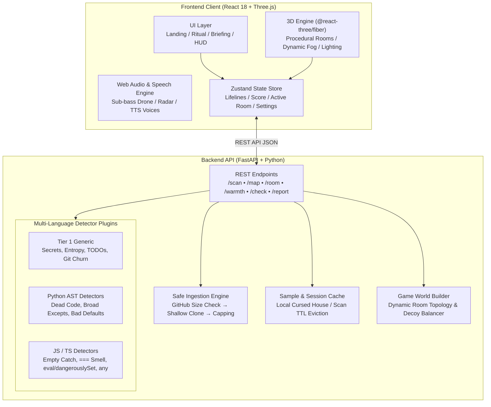

🕸️ 🎃 🦇

       ████████╗██╗  ██╗███████╗    ██╗      █████╗ ███████╗████████╗
       ╚══██╔══╝██║  ██║██╔════╝    ██║     ██╔══██╗██╔════╝╚══██╔══╝
          ██║   ███████║█████╗      ██║     ███████║███████╗   ██║   
          ██║   ██╔══██║╚════██║    ██║     ██╔══██║╚════██║   ██║   
          ██║   ██║  ██║███████║    ███████╗██║  ██║███████║   ██║   
          ╚═╝   ╚═╝  ╚═╝╚══════╝    ╚══════╝╚═╝  ╚═╝╚══════╝   ╚═╝   

        ██████╗ ██████╗ ███╗   ███╗███╗   ███╗██╗████████╗
       ██╔════╝██╔═══██╗████╗ ████║████╗ ████║██║╚══██╔══╝
       ██║     ██║   ██║██╔████╔██║██╔████╔██║██║   ██║   
       ██║     ██║   ██║██║╚██╔╝██║██║╚██╔╝██║██║   ██║   
       ╚██████╗╚██████╔╝██║ ╚═╝ ██║██║ ╚═╝ ██║██║   ╚═╝   
                       


> *"When a codebase is too messy, legacy-ridden, and insecure to live, it is sent here—to the estate."*

[](https://github.com/Haripriya24071/The-Last-Commit/actions)
[](https://opensource.org/licenses/MIT)
[](https://www.python.org/downloads/)
[](https://react.dev/)

---


## 🕯️ 01. The Idea in 30 Seconds

**The Last Commit** is an immersive browser horror game played entirely on real code. You provide a GitHub repository link (or use our built-in cursed sample project). The backend statically analyzes the project and rebuilds its architecture as a haunted Victorian mansion: folders become rooms and files become objects. 

Hidden among the objects are the real problems in your code (bugs, security flaws, and technical debt). Armed with a cursed map, a limited lantern, and four candles (lifelines), you hunt down the anomalies. Finding a real problem awards you a relic and points; clicking a healthy decoy triggers a jump scare and blows out a candle.

---

🧠 **What Makes It Different:**
- **Generated From Real Analysis:** Every unique repository yields an entirely distinct mansion layout.
- **Real Findings:** Every relic in the final report corresponds to a genuine code file, line number, and structural flaw.
- **Dual Experience:** Non-coders experience a thrilling atmospheric horror game with maps and jump scares; developers get a logic puzzle driven by real code architecture.
- **Safe & Static:** Code is strictly read via static analysis and **never executed**.

---

## 🛠️ 02. Comprehensive Tech Stack

The architecture separates concerns cleanly between a high-performance modern frontend and a secure Python analysis backend.

| Layer | Tool / Technology | Details & Role in Architecture |
| :--- | :--- | :--- |
| **Frontend UI & Dashboard** | React 18 + Vite | Modular UI with cinematic dark gothic styling, landing screen, briefing, and report modal. |
| **3D Rendering & Controls** | Three.js via `@react-three/fiber` & `@react-three/drei` | Procedural 3D Victorian rooms, dynamic lighting, interactive relics/decoys, floating 3D labels, and PointerLock controls with escape-pause menu. |
| **Horror Atmosphere & Shaders** | Custom WebGL shaders & CSS post-processing | Dynamic horror vignette, scanlines, flickering torches, and candle flame animations (with FAST performance toggle). |
| **State Management** | Zustand (`gameStore.js`) | Client-side game state (lifelines, score, active room, visited rooms, found relics, settings). |
| **Audio & Voice FX Engine** | Web Audio API + Web Speech API | Procedural 45Hz sub-bass binaural drone, dynamic heartbeat radar (`/api/warmth`), creaking iron door synth, and distinct text-to-speech voices for Ghost, Reaper, and Skeleton. |
| **Backend Framework** | Python 3.11+ / FastAPI + Uvicorn | High-performance asynchronous REST API with structured exception handling and input validation. |
| **Static Analysis Engine** | Python `ast`, JavaScript/TypeScript detectors, Shannon Entropy, `git log` | Multi-language static analyzer extracting security leaks, ghost bugs, complexity smells, and technical debt. |
| **Ingestion Pipeline** | Shallow Git Clone (`--depth 50`) & Local Cache | Safe repository cloning with file capping (400 files), GitHub API size validation, and offline cache fallback. |
| **Testing & Quality** | Pytest + Vitest | Comprehensive backend unit tests and frontend store testing. |

---

## 🚀 03. Running the Application

### Prerequisites
- **Python**: 3.11 or higher
- **Node.js**: v18.0 or higher
- **Git**: Installed and available in PATH

### 1. Start the Backend API Server
```bash
# Navigate to the backend directory
cd backend

# Create and activate a virtual environment
python -m venv .venv
# On Windows (PowerShell):
.venv\Scripts\Activate.ps1
# On Linux / macOS:
source .venv/bin/activate

# Install dependencies
pip install -r requirements.txt

# Start FastAPI development server on port 8000
uvicorn main:app --reload --host 127.0.0.1 --port 8000
```
Backend API will be live at: `http://127.0.0.1:8000` (Docs: `http://127.0.0.1:8000/docs`)

### 2. Start the Frontend Web Client
```bash
# In a new terminal, navigate to the frontend directory
cd frontend

# Install dependencies
npm install

# Start Vite development server
npm run dev
```
Frontend Web Client will be live at: `http://127.0.0.1:5173`

---

## 🏛️ 04. System Architecture



```text
       ┌────────────────────────────────────────────────────────┐
       │                BROWSER CLIENT (React + Vite)           │
       │  Landing Screen → Lore Briefing → Cursed Map → 3D Room │
       └───────────────────────────┬────────────────────────────┘
                                   │ REST Calls (JSON)
       ┌───────────────────────────▼────────────────────────────┐
       │               FASTAPI BACKEND (Python)                 │
       │    /api/scan   •   /api/map/{id}   •   /api/room/{id}   │
       │    /api/warmth •   /api/check      •   /api/report      │
       └─────┬─────────────────────┬────────────────────┬───────┘
             │                     │                    │
   ┌─────────▼────────┐  ┌─────────▼────────┐  ┌────────▼────────┐
   │  Safe Ingester   │  │ Detector Plugins │  │  Game Builder   │
   │ (Shallow Clone)  │  │(Python, JS/TS)   │  │(Rooms & Decoys) │
   └──────────────────┘  └──────────────────┘  └─────────────────┘
```

## 📡 05. REST API Reference

All endpoints return and accept JSON. If an error occurs, the server responds with a structured horror-themed error payload (`{ "error": true, "status_code": int, "detail": str, "message": str }`).

| Method | Endpoint | Description | Request Body / Params |
| :--- | :--- | :--- | :--- |
| `GET` | `/` | Root status banner & game version. | None |
| `GET` | `/health` | Liveness healthcheck. | None |
| `POST` | `/api/scan` | Clones/ingests repo, executes detector registry, creates session. | `{ "repo_url": "https://github.com/...", "role": "ghost" \| "reaper" \| "skeleton" }` |
| `GET` | `/api/map/{scan_id}` | Returns 5-room mansion layout, visits left, and whisper clues. | `scan_id` (path param) |
| `POST` | `/api/enter-room` | Spends 1 lantern visit (max 4) and unlocks room entry. | `{ "scan_id": "...", "room_name": "library" }` |
| `GET` | `/api/room/{scan_id}/{room}` | Retrieves 3D object nodes, spatial coordinates, and wall riddle. | `scan_id`, `room_name` (path params) |
| `POST` | `/api/warmth` | Computes quantized (5-level) distance warmth (0.0–1.0) for heartbeat radar. | `{ "scan_id": "...", "room_name": "library", "x": 0.0, "y": 1.6, "z": -2.0 }` |
| `POST` | `/api/check` | Evaluates clicked 3D object server-side. Returns relic details or jump scare damage. | `{ "scan_id": "...", "room_name": "library", "object_id": "obj_01" }` |
| `GET` | `/api/report/{scan_id}` | Generates Haunting Report (cleansed relics, missed relics, rank, code fixes). | `scan_id` (path param) |
| `POST` | `/api/cache/refresh` | Re-generates the local offline sample repository cache. | None |

---

## 📸 06. Visual Interface & Experience

The application is crafted with a high-contrast gothic aesthetic, dynamic torchlight shadows, and atmospheric post-processing.

```text
┌─────────────────────────────────────────────────────────────────────────────┐
│ 🕯️ THE LAST COMMIT — HAUNTING REPORT                                       │
│ Investigator: Detective Turing       Score: 350 pts       Rank: GHOST WHISPERER │
├─────────────────────────────────────────────────────────────────────────────┤
│ 🔮 PURGED RELICS (Found Anomalies)                                          │
│  • [reaper] sample_repo/config/secrets.env (Line 4)                          │
│    Issue: Hardcoded AWS Secret Access Key (Certain)                         │
│    Fix: Move secret to environment variables or secret manager.             │
│                                                                             │
│  • [skeleton] sample_repo/utils/helpers.py (Line 38)                         │
│    Issue: Lingering FIXME marker (Certain)                                  │
│    Fix: Address unresolved FIXME: handle unexpected API error properly.     │
│                                                                             │
│ 👁️ MISSED ANOMALIES (The House Keeps Its Secrets)                           │
│  • [ghost] sample_repo/utils/helpers.py (Line 5)                            │
│    Issue: Unused import: os (Possible)                                      │
├─────────────────────────────────────────────────────────────────────────────┤
│ [ 🔄 PLAY AGAIN (0 PTS) ]                   [ 🏚️ INVESTIGATE NEW REPO ]     │
└─────────────────────────────────────────────────────────────────────────────┘
```

Screenshots of every stage (Landing Screen, Ritual Loading, Cursed Mansion Map, 3D Procedural Room Exploration, and Haunting Report) can be captured in `/screenshots`.

---

## ⚠️ 08. Honest Limitations & Design Trade-offs

1. **Static-Only Scope (Zero Execution):** The analysis engine runs purely static heuristics (ASTs, regex patterns, entropy, and git history). It does not execute untrusted code or run test suites, which means dynamic runtime-only exceptions or database-state race conditions are outside its scope.
2. **File Capping for Real-Time Latency:** To guarantee responsive scan times (< 5–10s), analysis is capped at 400 prioritized source files per repository, prioritizing core logic files (`src/`, `lib/`, `app/`) over static assets, build outputs (`dist/`, `build/`), and vendor dependencies.
3. **Browser Audio Autoplay Policies:** Modern browsers block Web Audio and Speech Synthesis until the user performs an explicit interaction gesture. The landing page "Unlock Mansion" ritual satisfies this requirement.
4. **Headless GPU Limitations:** The Three.js 3D viewport utilizes WebGL 2.0. In headless test runners or virtualized environments without GPU acceleration, 3D rendering gracefully falls back to FAST mode or can be bypassed via direct API tests.
5. **Rate Limiting on Public GitHub API:** Repositories are fetched via anonymous git shallow clone. If `GITHUB_TOKEN` is not configured, the GitHub API size check gracefully skips size pre-validation and proceeds to safe shallow cloning.

---

🎃 *Created for The Turing Club Tech Team Auditions 2026 (Halloween Edition).*  
🦇 *Commit or Perish.*
